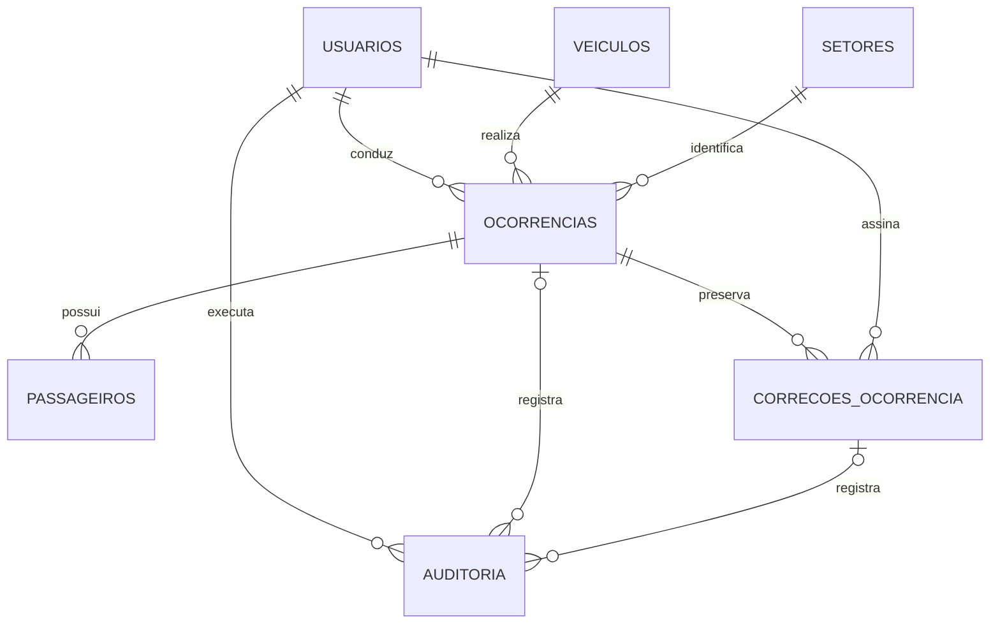

# Modelo MySQL

Modelo preparado para MySQL Server 8.0.16 ou superior. Workbench é o cliente de administração; o servidor MySQL armazena os dados.

## Entidades

| Tabela               | Finalidade                                                              |
| -------------------- | ----------------------------------------------------------------------- |
| usuarios             | Cadastro, hash de senha, perfil, situação e aprovação                   |
| veiculos             | Dados do veículo, ativação e exclusão lógica                            |
| setores              | Setores associados às viagens                                           |
| ocorrencias          | Viagem, horários completos, quilômetros e assinatura do condutor        |
| passageiros          | Nomes opcionais, sem exigir conta                                       |
| correcoes_ocorrencia | Proposta, justificativa, revisão original e assinaturas das duas partes |
| auditoria            | Registro de ações com autor e instante                                  |

## Relacionamentos

O desenho resume relações principais. O SQL inclui também criador, aprovador e assinante, todos com chaves estrangeiras.

## Regras confirmadas

### Cadastro

Condutor se cadastra como driver/pending. Conta pendente não acessa viagens. Administrador aprova e a conta passa a active. Perfil e status vindos do formulário público não são aceitos como autoridade. A criação da primeira conta administrativa usa o procedimento local descrito no [guia técnico](../docs/GUIA_TECNICO.md), não o cadastro público.

### Viagem atravessando a meia-noite

Saída e chegada usam DATETIME(3) com data completa, armazenada em UTC. A API converte os horários do fuso America/Sao_Paulo. Exemplo local: saída em 28/10/2026 às 23h e chegada em 29/10/2026 à 1h são válidas. O horário de chegada isolado não é suficiente para comparar. Os filtros de período consideram a data local de saída; os documentos apresentam saída e chegada no fuso local.

### Uma viagem em andamento por veículo e por condutor

Duas colunas geradas retornam o ID de veículo/condutor somente quando a ocorrência está in_progress. Índices únicos impedem dois registros abertos para a mesma pessoa ou veículo, inclusive sob concorrência. Chegada preenchida sem assinatura ainda mantém in_progress e o bloqueio.

A API verifica conflitos e informa que é necessário concluir a viagem anterior, incluindo assinatura. Também trata duplicidade do índice como HTTP 409. Não conclui automaticamente uma viagem nem descarta dados para iniciar outra. A resposta não revela detalhes de viagem de outro condutor.

### Quilometragem e conclusão

Distância é coluna gerada; não recebe entrada manual. CHECK impede km negativo, km final menor que inicial, chegada anterior à saída e ocorrência concluída sem assinatura do próprio condutor. A API valida formato/conteúdo da imagem, sessão e permissões: o banco não autentica o dono de um token JWT.

### CRUD de veículos

As rotas administrativas permitem criar (POST), consultar (GET), editar (PUT) e arquivar (DELETE) veículos. O arquivamento define ativo=0 e excluido_em, retirando o veículo dos cadastros disponíveis e preservando os vínculos com viagens anteriores. A desativação altera apenas ativo e permite reativação pela interface. Criação, edição e arquivamento registram auditoria na mesma transação. Todas essas operações exigem perfil admin na API.

### Correção e duas assinaturas

1. Um administrador ativo envia proposta, justificativa e assinatura para uma viagem concluída. A API valida os dados e permite somente uma proposta pendente por ocorrência.
2. O sistema guarda snapshot anterior, revisão-base e proposta. O registro oficial permanece como estava enquanto aguarda a assinatura do condutor.
3. Administrador responsável e condutor original são pessoas distintas e assinam a mesma proposta e justificativa, associadas ao hash do conteúdo canônico.
4. A proposta enviada com assinatura administrativa é imutável. A API não oferece edição da proposta nem reutiliza a assinatura anterior da ocorrência.
5. Na confirmação pelo condutor original ativo, a API bloqueia a ocorrência e a correção com SELECT FOR UPDATE. Confere autoria, revisão-base, estado atual, assinatura administrativa e integridade do conteúdo pelo hash.
6. O sistema aplica os campos e passageiros, vincula a nova assinatura do condutor à ocorrência, incrementa a revisão, marca a correção como aplicada e grava auditoria em uma única transação.
7. Propostas aplicadas, snapshots e assinaturas permanecem preservados no histórico. A correção não permite trocar o condutor responsável.

A assinatura do administrador é guardada na correção; a do condutor também atualiza a assinatura vigente da ocorrência. O snapshot anterior preserva a versão e assinatura substituídas. O SHA-256 serve para vincular conteúdo; não transforma o protótipo em assinatura certificada.

CHECK exige as duas assinaturas ao marcar uma correção como applied. A aplicação transacional e a autorização estão implementadas na API; o SQL isolado não impede um operador privilegiado de alterar registros diretamente. Recomenda-se não conceder acesso ao banco a usuários finais e restringir a conta da aplicação, sem DELETE em ocorrências/correções/auditoria nem UPDATE em auditoria.

## Estado atual e limites

O schema e os testes estruturais foram validados no MySQL 8.0.42 em instância temporária isolada, conforme registrado no [guia do banco](README.md). Cadastro, login, aprovação, gestão de veículos, setores e usuários, início, chegada, assinatura, conclusão e correções administrativas estão integrados à API e ao MySQL. A revisão é incrementada na chegada alterada, na conclusão e na aplicação de correções para proteger contra alterações concorrentes. Não existem tabelas paralelas ou dados simulados substituindo o banco.

Propostas de correção assinadas aguardam a confirmação do condutor. O MVP não oferece cancelamento nem rejeição dessas propostas.

## Referências técnicas

- [Índices UNIQUE e valores NULL](https://dev.mysql.com/doc/refman/8.0/en/create-index.html).
- [Índices em colunas geradas](https://dev.mysql.com/doc/refman/8.0/en/create-table-secondary-indexes.html).
- [CHECK disponível a partir de 8.0.16](https://dev.mysql.com/blog-archive/mysql-8-0-16-introducing-check-constraint/).
