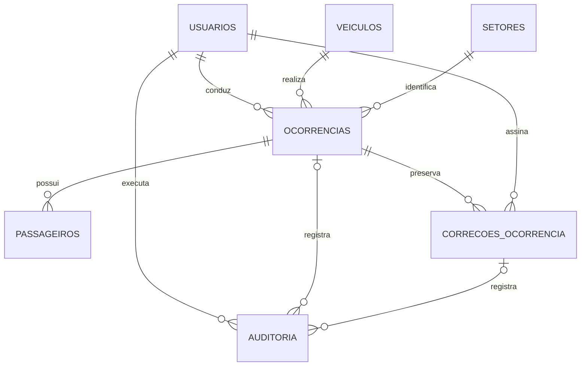

# Modelo MySQL

Modelo preparado para MySQL Server 8.0.16 ou superior. Workbench é o cliente de administração; o servidor MySQL armazena os dados.

## Entidades

| Tabela | Finalidade |
| --- | --- |
| usuarios | Cadastro, hash de senha, perfil, situação e aprovação |
| veiculos | Dados do veículo, ativação e exclusão lógica |
| setores | Setores associados às viagens |
| ocorrencias | Viagem, horários completos, quilômetros e assinatura do condutor |
| passageiros | Nomes opcionais, sem exigir conta |
| correcoes_ocorrencia | Proposta, justificativa, revisão original e assinaturas das duas partes |
| auditoria | Registro de ações com autor e instante |

## Relacionamentos

O desenho resume relações principais. O SQL inclui também criador, aprovador e assinante, todos com chaves estrangeiras.

## Regras confirmadas

### Cadastro

Condutor se cadastra como driver/pending. Conta pendente não acessa viagens. Administrador aprova e a conta passa a active. Perfil e status vindos do formulário público não são aceitos como autoridade. A primeira conta administrativa será criada por procedimento local documentado, não pelo cadastro público.

### Viagem atravessando a meia-noite

Saída e chegada usam DATETIME(3) com data completa, armazenada em UTC. A API converte os horários do fuso America/Sao_Paulo. Exemplo local: saída em 28/10/2026 às 23h e chegada em 29/10/2026 à 1h são válidas. O horário de chegada isolado não é suficiente para comparar. A data usada nos filtros e documentos será a data local de saída.

### Uma viagem em andamento por veículo e por condutor

Duas colunas geradas retornam o ID de veículo/condutor somente quando a ocorrência está in_progress. Índices únicos impedem dois registros abertos para a mesma pessoa ou veículo, inclusive sob concorrência. Chegada preenchida sem assinatura ainda mantém in_progress e o bloqueio.

A API consultará o conflito para informar ao condutor que precisa concluir a viagem anterior, incluindo assinatura. A API também tratará duplicidade do índice como HTTP 409. Não concluir automaticamente uma viagem nem descartar dados para iniciar outra. A resposta não revelará detalhes de viagem de outro condutor.

### Quilometragem e conclusão

Distância é coluna gerada; não recebe entrada manual. CHECK impede km negativo, km final menor que inicial, chegada anterior à saída e ocorrência concluída sem assinatura do próprio condutor. A API validará formato/conteúdo da imagem, sessão e permissões: o banco não autentica o dono de um token JWT.

### Correção e duas assinaturas

1. Administrador apresenta proposta e justificativa. Uma proposta pendente por ocorrência.
2. Guardar snapshot anterior, revisão-base e proposta. O registro oficial permanece como estava durante a coleta das assinaturas.
3. Administrador responsável e condutor da viagem assinam exatamente a mesma proposta e justificativa, associadas ao hash do conteúdo canônico.
4. Alterar conteúdo invalida ambas as assinaturas; nunca reutilizar assinatura anterior. Depois da primeira assinatura, a API deve impedir edição da proposta ou limpar ambas antes de aceitar qualquer alteração.
5. Com ambas as assinaturas, bloquear a ocorrência com SELECT FOR UPDATE e conferir revisão-base, condutor, perfis e estado atual. Validar novamente todos os dados propostos.
6. Aplicar os campos e passageiros, vincular a nova assinatura do condutor à ocorrência, incrementar revisão, marcar correção aplicada e gravar auditoria em uma única transação.
7. Propostas aplicadas, snapshots e assinaturas permanecem imutáveis. Não excluir o registro original do histórico. A API impedirá troca do condutor responsável em uma correção já assinada.

A assinatura do administrador é guardada na correção; a do condutor também atualiza a assinatura vigente da ocorrência. O snapshot anterior preserva a versão e assinatura substituídas. O SHA-256 serve para vincular conteúdo; não transforma o protótipo em assinatura certificada.

CHECK exige as duas assinaturas ao marcar uma correção como applied. A efetiva aplicação transacional e a autorização serão implementadas na API; o SQL isolado não impede um operador privilegiado de alterar registros diretamente. Não conceder acesso ao banco a usuários finais. A conta da aplicação não deverá ter DELETE em ocorrências/correções/auditoria nem UPDATE em auditoria.

## Limites desta etapa

Scripts executados e testes estruturais aprovados no MySQL 8.0.42 em instância temporária isolada. O usuário informou executar banco.sql no Workbench e a conexão local foi verificada. Cadastro, login, aprovação, início, chegada, assinatura e conclusão já estão integrados à API. A revisão é incrementada na chegada alterada e na conclusão para proteger a assinatura contra alterações concorrentes. O fluxo de correção administrativa com duas assinaturas ainda depende dos próximos endpoints. Não existem tabelas paralelas ou dados simulados substituindo o banco.

## Referências técnicas

- [Índices UNIQUE e valores NULL](https://dev.mysql.com/doc/refman/8.0/en/create-index.html).
- [Índices em colunas geradas](https://dev.mysql.com/doc/refman/8.0/en/create-table-secondary-indexes.html).
- [CHECK disponível a partir de 8.0.16](https://dev.mysql.com/blog-archive/mysql-8-0-16-introducing-check-constraint/).
